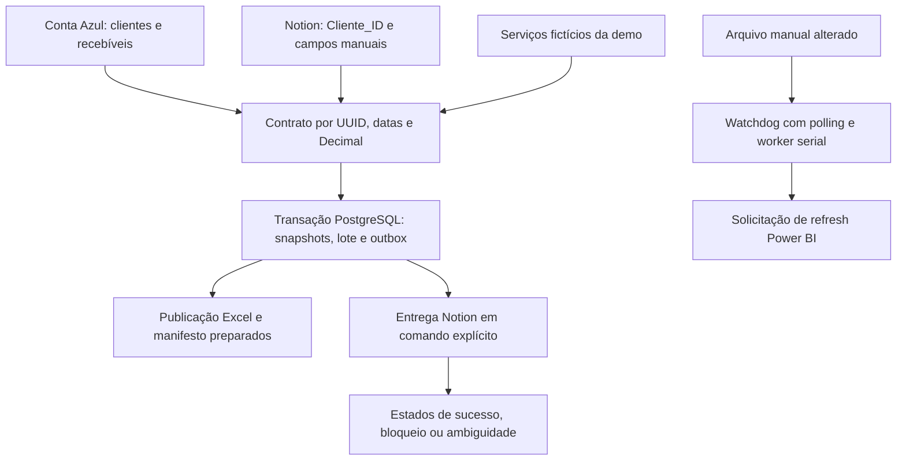

# Automação Financeira BI — Conta Azul, Notion, PostgreSQL e Power BI

Integração financeira em **Python** para acompanhamento de recebíveis vencidos,
cadastros e informações manuais de cobrança. A versão pública inclui HTTP e
OAuth com limites explícitos, carga transacional, fila de sincronização Notion,
exportação Excel, observador de arquivos e solicitação opcional de refresh.

A demonstração usa **dados fictícios, serviços simulados e PostgreSQL real
descartável**. Não exige contas ou arquivos da antiga empresa.

## Origem e contexto profissional

O projeto original foi descrito como uma solução para reduzir trabalho manual,
centralizar o acompanhamento financeiro e combinar informações automáticas do
Conta Azul com controles operacionais em Excel e Notion. O desenho de consumo
analítico envolvia PostgreSQL, Power BI, DAX, RPA, notificações Slack e rotinas
agendadas. Arquivos monitorados também podiam estar em pastas sincronizadas.

| Solução descrita na experiência original | Necessidades atendidas |
| --- | --- |
| Gestão de inadimplência | Clientes e valores em atraso, tempo de atraso, situação operacional e acompanhamento de cobranças. |
| Gestão de restituições | Valores pendentes, restituições concluídas, fluxo e evolução temporal a partir de controles manuais. |
| Integração manual e automática | Relacionar informações financeiras da API com acompanhamento operacional mantido pela equipe. |

O README original relata centralização, automação das atualizações e redução da
dependência operacional. Não apresenta medições publicadas que permitam
quantificar economia de tempo, custo ou latência. Esses relatos contextualizam
a experiência profissional; os resultados reproduzíveis deste repositório estão
descritos separadamente abaixo.

Dashboards, medidas DAX, macros Excel, arquivos de restituições, configurações de
agendamento e regras privadas não estão publicados. A amostra não reconstrói
macros ou fórmulas empresariais nem comprova atualização em tempo real.

## Arquitetura pública e limites de consistência



O PostgreSQL publica os dados e as intenções em uma transação. **Notion, banco,
arquivos e Power BI não formam uma transação distribuída.** Uma entrega externa
pode falhar depois do commit local e seu estado precisa ser acompanhado.

## Decisões de confiabilidade

| Risco | Tratamento |
| --- | --- |
| Homônimos e alterações de nome | Cliente_ID por UUID, sem atualização por título ou nome. |
| Falha em página de extração | Contratos e totais validados, limites de páginas/cursor e nenhuma carga parcial. |
| Ausência de vencidos | Zero é válido após coleta completa; gera snapshot vazio e flags falsas na cobertura consultada. |
| Dinheiro inválido | Decimal/NUMERIC, validação de total = pago + saldo, sem coerção silenciosa. |
| Carga interrompida | Snapshot, campos manuais, lote e outbox revertidos juntos no PostgreSQL. |
| Notion indisponível | Intenções persistidas com estados separados; criação ambígua não é repetida cegamente. |
| Troca acidental do destino | Data source Notion registrado no lote e conferido antes da entrega. |
| Perda de refresh token | Trava de renovação, escrita atômica e marcador de recuperação antes do POST. |
| Eventos simultâneos de arquivo | Worker único, debounce, cooldown e novas mudanças preservadas durante execução. |
| Falha na RPA | Mudança continua pendente e é tentada novamente; hashes confirmados só após sucesso. |
| Watchdog interrompido | Polling de segurança mantém a detecção de mudanças. |
| Perfil Chrome ocupado | Trava própria e preservação dos locks do navegador. |

O contrato completo está em [CONTRATO_DADOS.md](docs/CONTRATO_DADOS.md).
O significado de inadimplência é **saldo vencido positivo na janela consultada**,
não uma conclusão sobre qualquer dívida fora dessa cobertura.

## Demonstração reproduzível

Pré-requisitos do roteiro local: Windows, Python 3.12 e binários portáteis do
PostgreSQL 18.6. Consulte [REPRODUCAO.md](docs/REPRODUCAO.md) para obtenção e caminhos.

```powershell
python -m venv .venv
.\.venv\Scripts\python.exe -m pip install -r requirements-lock.txt
.\.venv\Scripts\python.exe -m pip check
$PgBin = (Resolve-Path '.local-test\runtime\pgsql\bin').Path
.\.venv\Scripts\python.exe -X utf8 scripts/validate_postgres.py --pg-bin "$PgBin" --demo
```

O comando cria bancos fictícios, executa a suíte e a demonstração, e encerra o
PostgreSQL. Não instala serviço Windows. Dependências e binários precisam estar
disponíveis; o script não baixa PostgreSQL automaticamente.

A amostra tem **3 clientes, 2 homônimos, 2 recebíveis, saldo 130.00 e 1 página
Notion inicial** com campos manuais. A entrega de três intenções e o refresh são
simulados, sem conta externa, Slack ou navegador real.

Saídas em `data/demo/`: `inadimplencia.xlsx` e `latest_run.json`. O Excel tem abas
Recebiveis, Clientes e Controle_Manual. Valores monetários são texto decimal para
preservar precisão; UUID e documento permanecem texto. O resultado da demo no
terminal inclui os estados dos serviços fictícios.

## Testes e CI

A suíte atual contém **65 testes: 41 de contrato, HTTP, OAuth, observador e RPA,
e 24 com PostgreSQL real**. A validação local e seus limites estão registrados
em [VALIDACAO.md](docs/VALIDACAO.md).

Os cenários cobrem rollback, reconciliação, concorrência, criação remota seguida
de timeout, recuperação por identidade, ausência de recebíveis, preservação de
campos manuais, erros de paginação, rotação de token e retomada do observador.

```powershell
.\.venv\Scripts\python.exe -X utf8 scripts/run_tests.py
```

Sem iniciar o banco, os casos PostgreSQL são explicitamente ignorados. Isso não
equivale à validação completa. O workflow preparado para GitHub Actions instala
dependências fixadas, executa pip check e exige PostgreSQL sem omissões. A primeira
execução no GitHub/Linux depende de publicação autorizada. Não há deploy automático.

## Organização e tecnologias

| Caminho | Responsabilidade |
| --- | --- |
| [src/cli.py](src/cli.py) | Comandos explícitos init, collect, sync, refresh e watch. |
| [src/clients.py](src/clients.py) | Adaptadores Conta Azul e Notion, com contratos de paginação. |
| [src/oauth.py](src/oauth.py) | Token local, rotação serializada e estado de recuperação. |
| [src/contracts.py](src/contracts.py) | Identidades, datas, dinheiro e reconciliação das fontes. |
| [src/database.py](src/database.py) | Publicação transacional e locks. |
| [src/sync.py](src/sync.py) | Entrega da outbox e controle de ambiguidade. |
| [src/pipeline.py](src/pipeline.py) | Coordenação da coleta, banco e arquivos. |
| [src/monitor.py](src/monitor.py) | Debounce, serialização, hashes e polling. |
| [src/automacao/RPA_Gestao_Financeira.py](src/automacao/RPA_Gestao_Financeira.py) | Solicitação de refresh, sem conclusão presumida. |
| [sql/001_schema.sql](sql/001_schema.sql) | Schema af, constraints, ledger, outbox e view. |
| [examples/fakes.py](examples/fakes.py) | Dados e serviços inteiramente fictícios. |
| [scripts/](scripts/) e [tests/](tests/) | Reprodução, demonstração e validação. |
| [.github/workflows/tests.yml](.github/workflows/tests.yml) | Testes preparados para runner e banco descartáveis. |

Stack pública: Python, requests, pandas, SQLAlchemy, PostgreSQL, openpyxl,
Watchdog e Selenium. Power BI/DAX, planilhas/macros e agendamento pertencem ao
contexto original, com seus artefatos não disponibilizados.

## Adaptação e segurança

Veja [.env.example](.env.example), [SECURITY.md](SECURITY.md) e os
[comandos de adaptação](docs/REPRODUCAO.md). Integrações externas ficam desativadas
por padrão e exigem --allow-live. Nunca usar contas ou sessões da antiga empresa.

O contrato novo exige UUID dos clientes nas páginas Notion. Não há migração
automática por nomes nem compatibilidade implícita com tabelas e configurações
legadas. Os entrypoints antigos foram mantidos como wrappers, sem efeitos na
importação ou subprocessos disparados automaticamente.

## Limites conhecidos

- APIs e navegador autenticados não foram homologados; a rede externa é bloqueada
  na demonstração e simulada nos testes. Documentação oficial orienta os adapters.
- Não há snapshot transacional entre páginas HTTP nem garantia exactly-once no Notion.
- RPA retorna requested e completion_verified=False; não confirma fim do refresh.
- O banco pode estar confirmado se a publicação de arquivo falhar depois dele.
- Dados locais são snapshots, sem histórico completo dos recebíveis. Ledger e
  outbox não substituem uma trilha contábil de versões das linhas.
- Um banco e token store por conta autorizada; não é plataforma multiempresa.
- Não há benchmark produtivo, migração de banco real, macros ou dashboard publicado.
- Locks e rotação ambígua podem exigir recuperação manual após queda de processo.
- O histórico original ainda contém exposição; reescrita e caches exigem ação
  autorizada separada. A correção atual não revoga credenciais.

## Competências demonstradas

Integração de APIs/OAuth, automação operacional, modelagem relacional, qualidade
financeira, limites de transações entre sistemas, recuperação após falhas e testes
de integração. O contexto de BI conecta a implementação às necessidades de
acompanhamento financeiro, sem confundir experiência profissional com resultados
da amostra pública.
